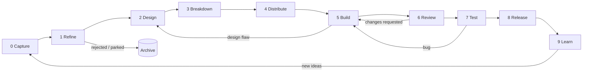

# Lifecycle: idea → production → learning

Owner: Orchestrator · Every work item lives in exactly one stage. Stage is tracked in `ai/work/BOARD.md` and in the item's front-matter.

## Fast lanes
| Type | Path |
|---|---|
| **feature** | full lifecycle |
| **bug** | 0 → (1 light: repro + expected) → 5 → 6 → 7 → 8 → 9 |
| **chore / refactor** | 0 → 3 → 5 → 6 → 8 (Architect approval if it crosses modules) |
| **spike** | 0 → 5 (time-boxed) → findings in `work/specs/` → back to 1 or 2 |
| **hotfix** | 5 → 6 (Security + one reviewer) → 8 → 9 postmortem within 48h |

## Stages

### 0 · Capture — Orchestrator
- Input: anything ("what if users could…").
- Do: create `ai/work/ideas/IDEA-<nnn>-<slug>.md` from `templates/idea.md`; one paragraph, raw. Add to BOARD.
- **Exit:** id assigned, Product pinged.

### 1 · Refine — Product (+ UX, Orchestrator)
- Do: problem, persona, evidence, success metric, user stories, acceptance criteria (Given/When/Then), out-of-scope, risks. Quick **Go / Park / Kill** decision.
- **Exit:** idea promoted to `ai/work/specs/SPEC-<nnn>-<slug>.md` with Product section complete, or archived with reason.

### 2 · Design — Architect + UX + Security (+ QA, DevOps)
- Architect: options & trade-offs, components, contracts, data changes, ADR if non-trivial.
- UX: flow (mermaid), screens/states, components, copy.
- Security: threat model, security requirements.
- QA: test plan from acceptance criteria. DevOps: infra/rollout/cost impact.
- Run **decision round** for open choices (`decision-protocol.md`).
- **Exit:** spec status `designed`; all personas signed off in the spec's sign-off table; no open blockers.

### 3 · Breakdown — Orchestrator (+ Architect, Engineer)
- Do: split into tasks `ai/work/tasks/TASK-<nnn>-<slug>.md` (≤ 1 day / ≤ ~400 LOC diff each), vertical slices preferred, explicit `depends_on`.
- Each task: acceptance criteria, files/areas likely touched, docs to update, tests required.
- **Exit:** every spec acceptance criterion maps to ≥1 task.

### 4 · Distribute — Orchestrator
- Assign owner persona/agent per task, order by deps, mark parallelizable ones.
- In multi-agent setups: one agent per independent task, each in its own branch/worktree.
- **Exit:** BOARD shows owners and order.

### 5 · Build — Engineer (+ any specialist for their slice)
- Read the task, spec and related knowledge docs. Implement + tests + doc updates.
- Can bounce back to stage 2 if design is wrong (note it in spec).
- **Exit:** task checklist complete, CI green locally, PR/diff ready.

### 6 · Review — multi-persona
- Always: Engineer peer review + Docs Keeper (doc-sync).
- Conditional: Security (sensitive areas), UX (UI change), Architect (boundaries/contracts/data).
- Use `templates/review.md`. Findings tagged **blocker / should / nit**.
- **Exit:** no blockers open.

### 7 · Test — QA
- Run test plan: e2e for acceptance criteria, regression of critical flows, exploratory.
- **Exit:** all AC pass; no critical/high bugs open.

### 8 · Release — DevOps
- Rollout plan (flag/canary/full), migrations, health checks, rollback plan, release notes (`templates/release.md`).
- **Human approval required** for production deploys unless policy says otherwise.
- **Exit:** deployed, health verified, release notes in `ai/work/releases/`.

### 9 · Learn — Product + Docs Keeper + DevOps
- Check success metric, errors, performance. Capture learnings.
- Docs Keeper: final doc-sync, ADR statuses, glossary, move items to `ai/work/archive/`.
- New ideas → stage 0.
- **Exit:** item closed on BOARD.

## Definition of Done (any item)
- [ ] Acceptance criteria met and tested
- [ ] Reviews passed (no blockers)
- [ ] `ai/knowledge/` updated per doc-sync matrix
- [ ] BOARD updated
- [ ] Released (or explicitly not required)
